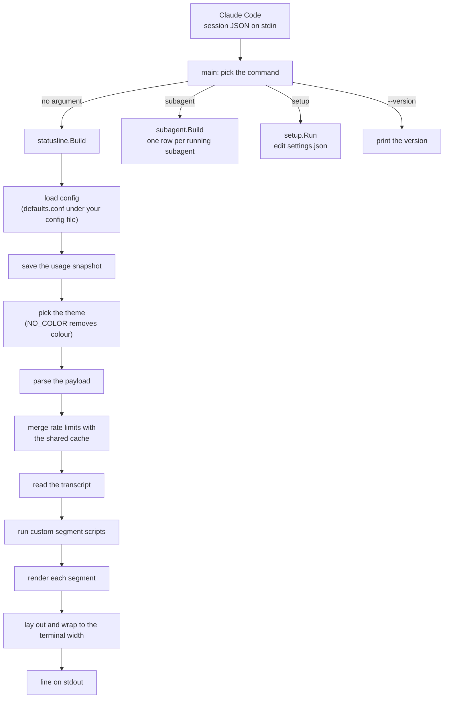
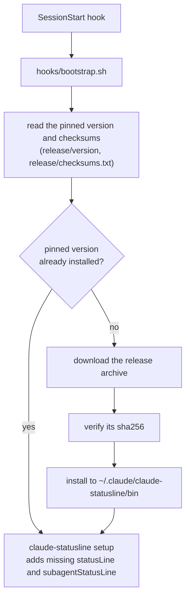

# claude-statusline

An open-source status line for Claude Code, written in Go.

It is at an early stage: for now it shows the working directory and git branch, model, context usage, token counts, prompt-cache hit rate and rate-limit usage bars, for example `~/code/app (main) · Opus 4.7 [high] · ctx: ████▎░░░░░ 42% · ↓ 1.5k · ↑ 23.4k · ⧉ 85% · 5h: ████████▌┃░░░░░░░░░ 45%`. It reads the session JSON that Claude Code passes on stdin, prints the line with no trailing newline (wrapping onto further rows when the terminal is too narrow), and always exits 0. Control characters are stripped from every string taken from the session, and anything unexpected results in blank output rather than an error.

## How it works

Claude Code runs the binary every time it redraws the status line, passing the session JSON on stdin. The binary reads your configuration and a few small files, then prints the line.



The plugin route adds a step before any of this, so that the binary is installed and wired in without you doing it by hand:



## Install

### As a Claude Code plugin

```text
/plugin marketplace add PaddleHQ/claude-statusline
/plugin install statusline@claude-statusline
```

On your next session start, a hook downloads the pinned release for your platform, checks its sha256 against the hashes committed in this repository, and installs it to `~/.claude/claude-statusline/bin`. It then runs `claude-statusline setup`, which sets `statusLine` and `subagentStatusLine` in `settings.json` only if you do not already have them, backing the file up first, and never touches either again. If an earlier install wired only `statusLine`, the next session adds `subagentStatusLine` once. Once the right version is installed, later sessions make no network requests.

### Manual install

#### From a release

Each [release](https://github.com/PaddleHQ/claude-statusline/releases) has a binary for macOS and Linux on arm64 and amd64, plus `checksums.txt`, an SBOM per archive and a GitHub build provenance attestation. Set the version and your platform, then download, verify and install:

```sh
VERSION=0.1.0   # without the leading v
OS=darwin       # or linux
ARCH=arm64      # or amd64
ARCHIVE="claude-statusline_${VERSION}_${OS}_${ARCH}.tar.gz"

gh release download "v${VERSION}" --repo PaddleHQ/claude-statusline \
  --pattern "$ARCHIVE" --pattern checksums.txt
shasum -a 256 -c checksums.txt --ignore-missing
gh attestation verify "$ARCHIVE" --repo PaddleHQ/claude-statusline

mkdir -p ~/.local/bin
tar -xzf "$ARCHIVE" -C ~/.local/bin claude-statusline
```

`shasum` checks the archive against the published checksums. `gh attestation verify` proves it was built by this repository's release workflow.

#### With Go

```sh
go install github.com/PaddleHQ/claude-statusline@latest
```

This builds from source into `$(go env GOPATH)/bin`.

#### Configure Claude Code

Add this to `~/.claude/settings.json`, using the path you installed to:

```json
{
  "statusLine": {
    "type": "command",
    "command": "~/.local/bin/claude-statusline",
    "refreshInterval": 60
  },
  "subagentStatusLine": {
    "type": "command",
    "command": "~/.local/bin/claude-statusline subagent"
  }
}
```

`subagentStatusLine` is optional; see [Subagent rows](#subagent-rows).

Run `claude-statusline --version` to print the installed version.

## Configuration

Configuration is optional. Your settings live in `~/.claude/claude-statusline/config`, or under `$CLAUDE_CONFIG_DIR` if you set it. Each line is `key = value`. Blank lines and full-line `#` comments are ignored, whitespace around keys and values is trimmed, and the last occurrence of a key wins. Keys are lower case, with at most one dot (`model.effort`); anything else is ignored. The file is parsed, never executed, so values are always plain text. A missing or invalid value falls back to its default.

[`internal/config/defaults.conf`](internal/config/defaults.conf) documents every key with a comment and its default value. The current keys are:

| Key | Default | Meaning |
|---|---|---|
| `segments` | `path model ctx tokens cache boot skills skills_stripped agent_skills mem rate5h rate7d` | Segments to show, in order. Unknown names are skipped. |
| `separator` | `·` | Glyph drawn between segments. |
| `theme` | `default` | Colour theme. Unknown names fall back to `default`. |
| `path.strip` | empty | Directory prefixes to strip from the path, separated by spaces; a leading `~` means your home directory. |
| `path.branch` | `true` | Show the git branch after the path (`true` or `false`). |
| `model.effort` | `true` | Show the effort level after the model name (`true` or `false`). |
| `ctx.width`, `ctx.width_medium`, `ctx.width_narrow` | `10`, `8`, `6` | Context bar width in cells at 160 columns or more, below 160, and below 120. |
| `ctx.warn` | `50` | Context usage percentage at or above which the fill turns amber. |
| `ctx.bad` | `90` | Context usage percentage at or above which the fill turns red. |
| `cache.warn` | `5` | Prompt cache hit percentage below which the cache figure turns red. |
| `rate5h.label`, `rate7d.label` | `5h`, `7d` | Text shown before the bar. |
| `rate5h.width`, `rate5h.width_medium`, `rate5h.width_narrow`, `rate7d.width`, `rate7d.width_medium`, `rate7d.width_narrow` | `20`, `14`, `10` | Bar width in cells at 160 columns or more, below 160, and below 120. |
| `rate5h.warn`, `rate7d.warn` | `20`, `10` | Pace deviation, in percentage points, beyond which the fill turns amber. |
| `rate5h.bad`, `rate7d.bad` | `40`, `20` | Pace deviation, in percentage points, beyond which the fill turns red. |
| `rate5h.hard_cap`, `rate7d.hard_cap` | `95` | Usage percentage at or above which the fill is always red. |
| `hooks.ttl` | `60` | Seconds a custom segment's result is reused before its script runs again. |
| `hooks.timeout` | `2` | Seconds a custom segment's script may run before it is killed. |
| `snapshot.enabled` | `true` | Save the latest session payload for other tools to read (`true` or `false`). |
| `snapshot.path` | empty | Where to save it; empty means `usage-latest.json` in your Claude config directory. |

Set `NO_COLOR` to any non-empty value to turn colour and styling off.

### Path and branch

The `path` segment shows the working directory (`workspace.current_dir`, else `cwd`). If it starts with one of the prefixes in `path.strip`, that prefix is removed (the longest match wins, and a prefix only matches whole directory names). Otherwise your home directory is shown as `~`, and any other path is shown as it is. For example, `path.strip = ~/code ~/projects` turns `/home/you/code/team/app` into `team/app`.

The branch comes from reading `.git` files, never from running `git`. The status line walks up from the directory to the first `.git`; if that is a file (a worktree or submodule) it follows its `gitdir:` pointer. A branch shows as `(main)` and a detached HEAD as the first seven characters of the commit. If the files cannot be read, the branch is left out.

### Context, tokens and cache

The `ctx` segment draws context-window usage as a bar with no pace marker. The fill is green below `ctx.warn`, amber from `ctx.warn` and red from `ctx.bad`, and its width follows the terminal in the same way as the rate-limit bars. The `tokens` segment shows session input and output totals as `↓ 1.5k · ↑ 23.4k`, truncating to one decimal place (`999`, `1.0k`, `999.9k`, `1.0M`); either half is left out when the payload does not report it. The `cache` segment shows `⧉ NN%`, the share of the latest request's input read from the prompt cache, in red when it falls below `cache.warn`. It is hidden when the request reported no input. Each segment is hidden when its data is missing.

### Rate-limit bars

The `rate5h` and `rate7d` segments draw your 5 hour and 7 day usage as a bar followed by the percentage. The vertical marker `┃` sits at the point in the window you would reach if you spent your quota evenly. The fill is green while your usage is close to the marker, amber once it drifts more than `warn` points either way, and red beyond `bad` points or at `hard_cap`. A bar disappears once its window has reset. Bars narrow on small terminals: each has a wide width, a `width_medium` used below 160 columns and a `width_narrow` used below 120 (`$COLUMNS`), and a bar is never under 4 or over 200 cells.

Rate limits belong to your account, not to a session, and an idle session's payload goes stale. Readings are therefore shared between sessions through `~/.claude/claude-statusline/cache/ratelimits` (under `$CLAUDE_CONFIG_DIR` if set). A session replaces the cached reading only with a newer window, higher usage, or a drop of more than 10 points (a mid-window quota reset), and the line is always drawn from the merged value. The file is private state and may change between versions.

### Transcript diagnostics

These segments are read from the session transcript (`transcript_path` in the payload). Only its first 40 lines and last 200 lines are read, each within a few megabytes, so a huge transcript costs nothing extra; a missing or unreadable transcript simply hides them. The `model` segment also uses it, and the rest are in the usage group.

| Segment | Shows | When |
|---|---|---|
| `model` | `Haiku (skill)` instead of the model name and effort | The latest assistant turn in the transcript ran a different model family (haiku, sonnet, opus, fable or mythos) than the session's, as happens when a skill or subagent sets its own model. |
| `boot` | `⌂ 64.5k` | Prompt tokens on the first assistant turn: the system prompt, tools, skill listing and memory before you have said anything. |
| `skills` | `⚙ 9.5k` | Size of the skill listing that is always loaded, as its length in characters divided by 4. |
| `skills_stripped` | `✗ skills 3/12` in red | 3 of 12 listed skills had their descriptions stripped to fit the listing budget. |
| `agent_skills` | `✗ agent skills 3/12` in amber | The same, for the subagent with the most stripped skills. |
| `mem` | `✗ mem` in red | A `SessionStart` hook's output was too large to inject, so Claude Code replaced it with a short preview. |

## Wrapping

The line is one row whenever it fits in `$COLUMNS` (visible width, ignoring colour; an unset or zero width never wraps). Otherwise it is laid out in groups:

- **Identity** (`path`, `model`, `ctx` and any hook in the `ctx` slot) packs into as few rows as it can.
- **Usage** (`tokens`, `cache`) starts the next row at the left margin. The **rates** (`rate5h` and `rate7d`, which are never split) follow on the same row, padded so that they line up under the second identity segment, or on a row of their own with the same indent if they do not fit.
- Hooks in the `usage` and `end` slots share one last row.

Rows after the first of a group are indented to line up under the segment after the path. The indent starts with a dim `↳`, because Claude Code trims leading spaces but not a glyph. If the indent would leave fewer than 24 columns, rows are not indented.

## Custom segments

Any executable file in `~/.claude/statusline.d/` (or `$STATUSLINE_HOOK_DIR`; under `$CLAUDE_CONFIG_DIR` if you set it) becomes a segment. Files are run in filename order; names that start with `.`, files that are not executable and directories are ignored. Hooks run concurrently, so the slowest one sets the delay, not the sum.

A hook is any script that reads the session JSON on stdin (and may ignore it) and prints one line. For example, `~/.claude/statusline.d/10-backup.sh`:

```sh
#!/bin/sh
# statusline-ttl: 300
if ~/bin/backup-is-stale; then
  printf '\033[31m⚠ backup stale\033[0m'
fi
exit 0
```

### The contract

| The hook... | The status line... |
|---|---|
| exits 0 and prints something | shows the first line |
| exits 0 and prints nothing | shows nothing: the hook has decided there is nothing to report |
| exits non-zero, or runs out of time | keeps showing the last line it printed, and does not try again for a TTL |

A failure keeps the last line rather than blanking it, so "could not tell" is not mistaken for "nothing to report". Standard error is discarded. A timeout kills the hook and everything it started.

Output is used as it is, so a hook chooses its own colours. Control characters are stripped, except for colour sequences (`ESC [ ... m`), so a hook cannot move the cursor or redraw the screen.

### Placement

A hook's name is its filename without a leading `NN-` and without its extension, so `10-backup.sh` is `backup`.

- If the name is in `segments`, the hook is drawn there: `segments = backup path model ctx tokens cache rate5h rate7d` puts it first.
- If the name is a built-in segment that is in `segments` (`model`, say), the hook replaces the built-in.
- Any other hook goes to its slot, chosen by a comment in the first 20 lines of the script: `# statusline-slot: ctx` (the default) draws it straight after `ctx`, or after `model` when there is no `ctx`; `usage` draws it after `tokens` and `cache`; `end` draws it last. Any other slot name means `ctx`, so a typo shows up on the line.

### Timeouts and caching

A hook runs at most once per TTL, per session. The default is `hooks.ttl` (60 seconds), and a hook can set its own with `# statusline-ttl: <seconds>` in its first 20 lines. A hook that takes longer than `hooks.timeout` (2 seconds) is killed. `STATUSLINE_HOOK_TTL` and `STATUSLINE_HOOK_TIMEOUT` override both settings.

Results are cached in `~/.claude/claude-statusline/cache/hooks/<session id>/` (under `$CLAUDE_CONFIG_DIR` if set), one file per hook, because a hook is given the session JSON and its output may differ from one session to the next. Cache directories untouched for 7 days are removed when a new session's is created. The files are private state and may change between versions.

## Subagent rows

Claude Code's agent panel lists the subagents you have running. `claude-statusline subagent` is a `subagentStatusLine` command that draws each row as

```
reviewer · sonnet-4-5 [high] · ctx: ████▎░░░░░ 42% · 84.5k · Review the payment retry change
```

that is the agent's name (or its task kind when it has no name), its model without the `claude-` prefix and date suffix, the reasoning effort, a context bar with the percentage of the model's context window used, the token count and the task description. Each part is left out when Claude Code does not send it, so older versions show fewer parts. The bar is the same as the `ctx` segment's: it uses the `ctx.*` widths, warning and bad thresholds, narrows with the panel's `columns`, and follows `theme`, `separator` and `NO_COLOR`. Control characters are stripped from everything Claude Code sends. The command prints nothing and exits 0 whatever it is given, so Claude Code falls back to its default rows. A task without an `id` keeps the default row.

## Usage snapshot

Every time the status line renders, the payload Claude Code sent is saved, byte for byte, to `~/.claude/usage-latest.json` (under `$CLAUDE_CONFIG_DIR` if set) so that other tools can read your latest usage and rate limits. The file is replaced atomically, is readable only by you, and is written only when the payload is valid JSON. A failed write never affects the status line. Set `snapshot.enabled = false` to turn it off, or `snapshot.path` to write it somewhere else.

## Releases

Every release is published from this repository's release workflow, so you can check what you download. The commands under [From a release](#from-a-release) verify the archive against the published checksums and against its build provenance attestation. The plugin does the checksum check for you, against hashes committed to this repository.

To work on the code, see [CONTRIBUTING.md](CONTRIBUTING.md).

## Licence

Released under the terms in [LICENSE](LICENSE).
