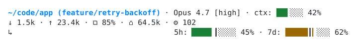

# Customising

For what the tool is and how to install it, see the [README](../README.md). For what runs when, see [How it works](how_it_works.md).

## Configuration

Configuration is optional. Your settings live in `~/.claude/claude-statusline/config.yaml`, or under `$CLAUDE_CONFIG_DIR` if you set it. The file is [YAML](https://yaml.org): the global keys sit at the top level, and each segment's keys sit in a mapping named after it, so `model.effort` below is written like this:

```yaml
segments: [path, model, rate5h]
separator: "|"
model:
  effort: false
path:
  strip: ["~/code", "~/my projects"]
ctx: {warn: 60, bad: 85}
```

Lists are YAML lists, `true` and `false` are YAML booleans, numbers are whole numbers and everything else is a string. Quote a string that YAML would otherwise read as something else, such as a separator of `|` or a path starting with `~`. The file is parsed, never executed, so values are always plain text.

A setting you leave out keeps its default, including the other keys of a segment you only partly set. If the file is not valid YAML (or is not a mapping), the whole file is ignored and the defaults apply. The status line then shows a [red row](#mistakes-in-the-config-file) above the line to say so. A key the status line does not know, a value of the wrong type (such as `width: wide`), an empty string or list, a string with control characters, or a number that is negative or has more than 12 digits is ignored on its own. That one key falls back to its default while the rest of the file still applies. The one exception is `segments_excluded`, where `[]` is kept and means leave out nothing. None of these shows the row, but `config-check` lists the keys it does not know.

[`internal/config/defaults.yaml`](../internal/config/defaults.yaml) documents the global keys with a comment and their default values, and each segment's own `defaults.yaml` under [`segments/`](../segments) does the same for the keys in its section. In the table, `section.key` means `key` inside the `section` mapping. The current keys are:

| Key | Default | Meaning |
|---|---|---|
| `segments` | `[path, model, ctx, tokens, cache, cost, boot, skills, skills_stripped, agent_skills, mem, rate5h, rate7d]` | Segments to show, in order, as a list. Unknown names are skipped. |
| `segments_excluded` | `[cost]` | Built-in segments to leave out of `segments`, as a list; `[]` leaves out nothing. See [Segments and order](#segments-and-order). |
| `separator` | `·` | Glyph drawn between segments. |
| `theme` | `classic` | Colour theme: a built-in name (`classic` or `gradient`) or the path to a theme file. Anything that cannot be used falls back to `classic`. See [Themes](#themes). |
| `path.strip` | `[]` | Directory prefixes to strip from the path, as a list; an entry may contain spaces, and a leading `~` means your home directory. |
| `path.branch` | `true` | Show the git branch after the path (`true` or `false`). |
| `path.worktrees` | `[]` | Directories that hold git worktrees, as a list; relative entries are relative to the main repository, and a leading `~` means your home directory. Empty means off. |
| `path.emoji` | `false` | Show the theme's emoji before the branch: 🌿 for a branch and 🌳 for a worktree in the built-in themes (`true` or `false`). |
| `model.effort` | `true` | Show the effort level after the model name (`true` or `false`). |
| `ctx.width`, `ctx.width_medium`, `ctx.width_narrow` | `10`, `8`, `6` | Context bar width in cells at 160 columns or more, below 160, and below 120. |
| `ctx.warn` | `50` | Context usage percentage at or above which the fill turns amber. |
| `ctx.bad` | `90` | Context usage percentage at or above which the fill turns red. |
| `cache.warn` | `5` | Prompt cache hit percentage below which the cache figure turns red. |
| `cost.warn` | `5` | Session cost in whole US dollars at or above which the figure turns amber. |
| `cost.bad` | `20` | Session cost in whole US dollars at or above which the figure turns red. |
| `rate5h.label`, `rate7d.label` | `5h`, `7d` | Text shown before the bar. |
| `rate5h.width`, `rate5h.width_medium`, `rate5h.width_narrow`, `rate7d.width`, `rate7d.width_medium`, `rate7d.width_narrow` | `20`, `14`, `10` | Bar width in cells at 160 columns or more, below 160, and below 120. |
| `rate5h.warn`, `rate7d.warn` | `20`, `10` | Pace deviation, in percentage points, beyond which the fill turns amber. |
| `rate5h.bad`, `rate7d.bad` | `40`, `20` | Pace deviation, in percentage points, beyond which the fill turns red. |
| `rate5h.hard_cap`, `rate7d.hard_cap` | `95` | Usage percentage at or above which the fill is always red. |
| `hooks.ttl` | `60` | Seconds a custom segment's result is reused before its script runs again. |
| `hooks.timeout` | `2` | Seconds a custom segment's script may run before it is killed. |
| `snapshot.enabled` | `true` | Save the latest session payload for other tools to read (`true` or `false`). |
| `snapshot.path` | empty | Where to save it; empty means `usage-latest.json` in your Claude config directory. A relative path is taken from the `claude-statusline` directory inside it. |

### Starting from the defaults

`claude-statusline config` prints every setting with its default and its explanation, all commented out. Redirect it to your config file, then open the file:

```sh
claude-statusline config > ~/.claude/claude-statusline/config.yaml
```

Every line is commented out, so an editor's toggle-comment command on a selected block turns the settings into live ones and leaves the explanations commented. A setting inside a section needs the section header uncommented as well (`hooks:` above `ttl: 60`), or the key lands at the top level and is ignored. Delete the settings you do not change: a setting you leave in the file keeps its current default even when a later release changes it. An untouched copy changes nothing. `config` reads no environment or config, so it prints the same text everywhere. Plugin users, who may not have `claude-statusline` on their `PATH`, can use the binary under `plugins/data/statusline-claude-statusline/bin/` in the Claude config directory.

### Mistakes in the config file

When `config.yaml` exists but cannot be used, the status line draws one red row above the normal line, which is drawn from the defaults:

```text
~/.claude/claude-statusline/config.yaml:12 did not find expected key · run /statusline:config-check
```

The file cannot be used when it is not valid YAML (a duplicate key counts), when its top level is not a mapping, when it is larger than 1 MiB, or when it cannot be read or is not a regular file. A missing file, an empty file and a file with only comments are fine. The row is one row, never wrapped, and is trimmed to the terminal width counted in characters (a wide East Asian character counts as one), from the path first, then the hint, then the reason. The agent panel rows never show it.

Run `/statusline:config-check` in Claude Code, or `claude-statusline config-check` in a terminal, for the full report. It starts with `Config file:` and the path, then says one of:

- `Parsed without errors.`
- `Does not exist, so the defaults apply.`
- the line, the parser's reason, and the lines around it, with `>` marking the line the parser named. Each context line is cut at 200 characters.
- a reason with no line, when the file cannot be read, is not a regular file, is too large or is not a mapping.

With no config directory, the first line is `Config file: none` and the defaults apply.

After a good parse it also lists the settings it does not know, such as a key you uncommented without its section header, or a dotted key like `ctx.warn` (a section header on its own is fine):

```text
Unknown settings (ignored):
  ttl
```

Unknown settings never show the red row. The command exits with status 1 only when the config cannot be used. A line number is where the parser noticed the problem, which is not always where the mistake is: a missing `]` on one line can be reported on a later one, and a bad indent can be reported on the line before it.

Set `NO_COLOR` to any non-empty value to turn colour and styling off; see [NO_COLOR](how_it_works.md#no_color).

## Segments and order

`segments` lists what the line shows, left to right. To see what your own line shows, with your thresholds and custom segments, run `/statusline:help` in Claude Code, or `claude-statusline help` in a terminal. The built-in segments are:

| Segment | Shows |
|---|---|
| `path` | The working directory, with the git branch after it. |
| `model` | The model name, with the effort level after it. |
| `ctx` | Context-window usage as a bar. |
| `tokens` | Session input and output token totals. |
| `cache` | The prompt cache hit rate. |
| `cost` | What the session would cost at API prices; see [Cost](#cost). |
| `boot`, `skills`, `skills_stripped`, `agent_skills`, `mem` | Facts read from the transcript; see [Transcript diagnostics](how_it_works.md#transcript-diagnostics). |
| `rate5h`, `rate7d` | Your 5 hour and 7 day usage as bars. |

Reorder or drop segments by editing the list, for example `segments: [path, model, rate5h]`.

To drop a few segments without copying the whole list, name them in `segments_excluded` instead, for example `segments_excluded: [cost, boot]`. It applies to whatever `segments` holds, the default or your own, and it only turns off built-in segments. A [custom segment](#custom-segments) with an excluded name still runs, and goes to its slot as if its name were not in `segments`, so a script of your own called `cost.sh` keeps showing. Custom segments cannot be excluded: to stop one, remove its script from the hook directory, or make it not executable (`chmod -x`). Its default is `[cost]`, which is why the cost is not shown even though `cost` is in the default `segments`. Your `segments_excluded` replaces that default rather than adding to it, so to exclude `boot` and keep the cost hidden, write `segments_excluded: [cost, boot]`. `segments_excluded: []` leaves out nothing. `/statusline:help` lists what is left out under "Left out by segments_excluded".

A segment is hidden, not wrong, when its data is missing. A name that is not a built-in segment is skipped unless a [custom segment](#custom-segments) has that name.

### Path and branch

The `path` segment shows the working directory (`workspace.current_dir`, else `cwd`). If it starts with one of the prefixes in `path.strip`, that prefix is removed (the longest match wins, and a prefix only matches whole directory names). Otherwise your home directory is shown as `~`, and any other path is shown as it is. For example, `strip: ["~/code", "~/projects"]` in the `path` section turns `/home/you/code/team/app` into `team/app`.

The branch comes from reading `.git` files, never from running `git`. The status line walks up from the directory to the first `.git`; if that is a file (a worktree or submodule) it follows its `gitdir:` pointer. A branch shows as `(main)` and a detached HEAD as the first seven characters of the commit. If the files cannot be read, the branch is left out.

To collapse the long path of a git worktree, list where your worktrees live in `path.worktrees`, for example `worktrees: [.claude/worktrees, .worktrees]` (`.claude/worktrees` is where Claude Code puts its own). A session inside a linked worktree whose root sits under one of the entries shows the main repository's name instead of the path up to the worktree root, and keeps what follows it: `app (fix)` in `/home/you/app/.worktrees/fix`, and `app/pkg/sub (fix)` in its `pkg/sub`. The branch gets the theme's `worktree` colour, and `path.emoji` adds the theme's worktree glyph (`glyphs.worktree`, 🌳 in the built-in themes). `path.strip` is ignored for a worktree. A worktree outside the listed directories, and the main repository itself, are shown as usual.

How entries are matched:

- A relative entry is taken from the main repository's root.
- Matching is lexical, so the working directory has to be spelled with the same case as the directories git recorded.
- An absolute entry is compared with the working directory as Claude Code spells it, so write it the same way (for example `/tmp/...`, not `/private/tmp/...`); a relative entry matches in either spelling.
- A relative entry needs the main repository's root in that spelling, and when it cannot be worked out, the worktree is shown as usual; an absolute entry still collapses.

### Context, tokens and cache

The `ctx` segment draws context-window usage as a bar with no pace marker. The fill is green below `ctx.warn`, amber from `ctx.warn` and red from `ctx.bad`, and its width follows the terminal in the same way as the rate-limit bars. The `tokens` segment shows session input and output totals as `↓ 1.5k · ↑ 23.4k`, truncating to one decimal place (`999`, `1.0k`, `999.9k`, `1.0M`); either half is left out when the payload does not report it. The `cache` segment shows `⧉ NN%`, the share of the latest request's input read from the prompt cache, in red when it falls below `cache.warn`. It is hidden when the request reported no input. Each segment is hidden when its data is missing.

### Cost

The `cost` segment shows the session's cost in US dollars as `$1.23`: amber from `cost.warn` dollars and red from `cost.bad`. It is hidden when the payload reports no cost.

It is off by default: `cost` is in the default `segments`, after `cache`, but also in the default `segments_excluded`. To show it, set `segments_excluded: []`, or list only what you do want left out.

Claude Code reports this figure: its own estimate of the session's tokens priced at the public API rates. What it means depends on how you pay:

- **API key (pay as you go):** it is roughly what the session has cost you. Your bill is the authority, so treat the figure as an estimate.
- **Pro or Max subscription:** you pay a flat fee, so the figure is notional. It is what the same work would have cost on the API, not money you are charged, and it does not count against anything. It is still useful for comparing sessions and for spotting an expensive one. What limits a subscription is your 5 hour and 7 day usage, which `rate5h` and `rate7d` show.

### Bars and widths

The `rate5h` and `rate7d` segments draw your 5 hour and 7 day usage as a bar followed by the percentage. The vertical marker `┃` sits at the point in the window you would reach if you spent your quota evenly. The fill is green while your usage is close to the marker, amber once it drifts more than `warn` points either way, and red beyond `bad` points or at `hard_cap`. A bar disappears once its window has reset. Bars narrow on small terminals: each has a wide width, a `width_medium` used below 160 columns and a `width_narrow` used below 120 (`$COLUMNS`), and a bar is never under 4 or over 200 cells. Readings are shared between sessions; see [Shared rate-limit cache](how_it_works.md#shared-rate-limit-cache).

## Custom segments

Any executable file in `~/.claude/statusline.d/` (or `$STATUSLINE_HOOK_DIR`, which must be an absolute path and is ignored otherwise; under `$CLAUDE_CONFIG_DIR` if you set it) becomes a segment. Files are run in filename order; names that start with `.`, files that are not executable and directories are ignored. Hooks run concurrently, so the slowest one sets the delay, not the sum.

A hook is any script that reads the session JSON on stdin (and may ignore it) and prints one line. For example, `~/.claude/statusline.d/10-backup.sh`:

```sh
#!/bin/sh
# statusline-ttl: 300
if ~/bin/backup-is-stale; then
  printf '\033[31m⚠ backup stale\033[0m'
fi
exit 0
```

While the backup is stale, the line shows it right after the context bar:

<picture>
  <source media="(prefers-color-scheme: dark)" srcset="images/custom-segment-dark.svg">
  
</picture>

### The contract

| The hook... | The status line... |
|---|---|
| exits 0 and prints something | shows the first line |
| exits 0 and prints nothing | shows nothing: the hook has decided there is nothing to report |
| exits non-zero, or runs out of time | keeps showing the last line it printed, and does not try again for a TTL |

A failure keeps the last line rather than blanking it, so "could not tell" is not mistaken for "nothing to report". Standard error is discarded. A timeout kills the hook and everything it started.

Output is used as it is, so a hook chooses its own colours. Control characters are stripped, except for colour sequences (`ESC [ ... m`), so a hook cannot move the cursor or redraw the screen.

### Placement

A hook's name is its filename without a leading `NN-` and without its extension, so `10-backup.sh` is `backup`.

- A name in `segments_excluded` does not stop the hook: it still runs, in its slot. To stop it, remove the script or make it not executable; see [Segments and order](#segments-and-order).
- If the name is in `segments`, the hook is drawn there: `segments: [backup, path, model, ctx, tokens, cache, rate5h, rate7d]` puts it first.
- If the name is a built-in segment that is in `segments` (`model`, say), the hook replaces the built-in.
- Any other hook goes to its slot, chosen by a comment in the first 20 lines of the script: `# statusline-slot: ctx` (the default) draws it straight after `ctx`, or after `model` when there is no `ctx`; `usage` draws it after `tokens`, `cache` and `cost`; `end` draws it last. Any other slot name means `ctx`, so a typo shows up on the line.
- A comment `# statusline-help: <text>` in the first 20 lines is the description that `/statusline:help` and `claude-statusline help` show for the hook. The text is cut at 200 characters. Without one, the help says "custom segment from" and the file name. Help only reads the script's header; it never runs it.

### Timeouts and caching

A hook runs at most once per TTL, per session. The default is `hooks.ttl` (60 seconds), and a hook can set its own with `# statusline-ttl: <seconds>` in its first 20 lines. A hook that takes longer than `hooks.timeout` (2 seconds) is killed. `STATUSLINE_HOOK_TTL` and `STATUSLINE_HOOK_TIMEOUT` override both settings.

Results are cached in `cache/hooks/<session id>/` in the status line's state directory (the plugin data directory for a plugin install; see [Where the files live](how_it_works.md#where-the-files-live)), one file per hook, because a hook is given the session JSON and its output may differ from one session to the next. Cache directories untouched for 7 days are removed when a new session's is created. The files are private state and may change between versions.

## Wrapping

The line is one row whenever it fits in `$COLUMNS` (visible width, ignoring colour; an unset or zero width never wraps). Otherwise it is laid out in groups:

- **Identity** (`path`, `model`, `ctx` and any hook in the `ctx` slot) packs into as few rows as it can.
- **Usage** (`tokens`, `cache`, `cost`) starts the next row at the left margin. The **rates** (`rate5h` and `rate7d`, which are never split) follow on the same row, padded so that they line up under the second identity segment, or on a row of their own with the same indent if they do not fit.
- Hooks in the `usage` and `end` slots share one last row.

Rows after the first of a group are indented to line up under the segment after the path. The indent starts with a dim `↳`, because Claude Code trims leading spaces but not a glyph. If the indent would leave fewer than 24 columns, rows are not indented.

At 80 columns the same line as at the top of the README wraps into three rows:

<picture>
  <source media="(prefers-color-scheme: dark)" srcset="images/narrow-dark.svg">
  
</picture>

## Subagent rows

Claude Code's agent panel lists the subagents you have running. `claude-statusline subagent` is a `subagentStatusLine` command that draws each row as the agent's name (or its task kind when it has no name), its model as a family and version (`Opus 4.7`, with any date suffix dropped, or the id without its `claude-` prefix when it is not in that form), the reasoning effort, a context bar with the percentage of the model's context window used, the token count and the task description:

<picture>
  <source media="(prefers-color-scheme: dark)" srcset="images/subagent-dark.svg">
  
</picture>

Each part is left out when Claude Code does not send it, so older versions show fewer parts. The bar is the same as the `ctx` segment's: it uses the `ctx.*` widths, warning and bad thresholds, narrows with the panel's `columns`, and follows `theme`, `separator` and `NO_COLOR`. Control characters are stripped from everything Claude Code sends. The command prints nothing and exits 0 whatever it is given, so Claude Code falls back to its default rows. A task without an `id` keeps the default row.

## Themes

A theme sets the colours and the bar glyphs. Two come built in:

- `classic` is the default: eighth-block bars filled in green, amber or red by pace, in basic terminal colours that suit light and dark backgrounds.
- `gradient` draws whole-cell bars whose colour runs from green through amber to red along the bar. The pace colour moves to the percentage after the bar, so the bar shows how much you have used and the number shows how you are doing against the pace.

Pick one in your config file:

```yaml
theme: gradient
```

<picture>
  <source media="(prefers-color-scheme: dark)" srcset="images/gradient-dark.svg">
  
</picture>

The older name `default` still works and means `classic`.

### Your own theme

Point `theme` at a YAML file. A value that contains `/` or starts with `~` is a path: `~` is your home directory, and a relative path is taken from the `claude-statusline` directory next to your config file.

```yaml
theme: "~/.config/claude-statusline/ocean.yaml"
```

To write one, copy a built-in theme and edit it: [`classic.yaml`](../themes/classic.yaml) for solid bars or [`gradient.yaml`](../themes/gradient.yaml) for gradient ones. Both are commented, and the file you point `theme` at must be complete: every field below is required, with two exceptions. `colors.branch`, `colors.worktree` and the `glyphs` section can be left out, and so can `bar.empty_color` and `bar.marker_color` in a `gradient` bar. A theme does not inherit from another.

```yaml
colors:
  text: ""
  muted: dim
  good: green
  warn: yellow
  bad: red
  marker: bold
  path: green
  branch: green
  worktree: bold 208

glyphs:
  branch: "🌿"
  worktree: "🌳"

bar:
  style: gradient
  full: "▰"
  empty: "▱"
  marker: "/"
  ramp: ["#7aa2f7", "#e0af68", "#f7768e"]
  empty_color: bright-black
  marker_color: bold
```

| Field | Meaning |
|---|---|
| `colors.text`, `muted`, `good`, `warn`, `bad`, `marker`, `path` | A colour for each role. `text` is labels and figures, `muted` is separators and empty bar cells, `good`, `warn` and `bad` colour the bar fill, `marker` is the pace marker and `path` is the working directory. An empty string uses the terminal's own colour. |
| `colors.branch`, `colors.worktree` | Optional. The branch, and the branch of a linked worktree, in the `path` segment. `branch` defaults to the `path` colour and `worktree` to `bold 208`. |
| `glyphs.branch`, `glyphs.worktree` | Optional. The emoji shown before a branch and before a worktree, 🌿 and 🌳 by default. Each must be a non-empty string without control characters, and must take at least one column. A character followed by the emoji selector U+FE0F (such as `❤️`) counts as two columns, as it does in Claude Code. |
| `bar.style` | `solid` or `gradient`. |
| `bar.full`, `bar.empty`, `bar.marker` | The glyphs for a full cell, an empty cell and the pace marker. |
| `bar.partials` | Seven glyphs for a cell filled by one to seven eighths. Required for `solid`; a `gradient` bar fills whole cells and leaves it out. |
| `bar.ramp` | Three `#rrggbb` stops, for good, warn and bad. Needed for `gradient`. |
| `bar.empty_color`, `bar.marker_color` | Colours for empty cells and the marker in a `gradient` bar. |

A colour is a space-separated list of tokens, applied in order: `bold`, `dim`, `italic`, `underline`, a name (`black`, `red`, `green`, `yellow`, `blue`, `magenta`, `cyan`, `white`, or `bright-` followed by one of those), a number from 0 to 255 for the 256-colour palette, or `#rrggbb` for a true colour. At most one token may be a colour, so `bold 33` and `underline #ff8800` are valid and `red blue` is not.

A theme is checked strictly. An unknown theme name, an unreadable file, invalid YAML, an unknown key, a bad colour, a missing field, a wrong number of glyphs, or an empty, zero-width or control-character glyph all make the status line use `classic` instead, silently, rather than applying half a theme. If your theme does not seem to apply, a typo in a key is the usual cause.
