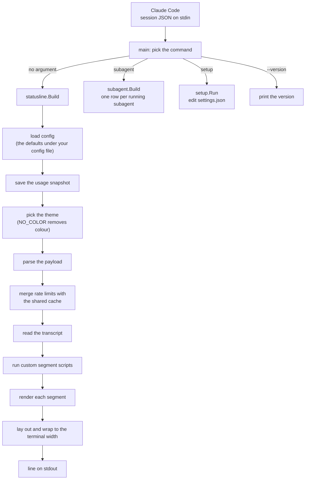
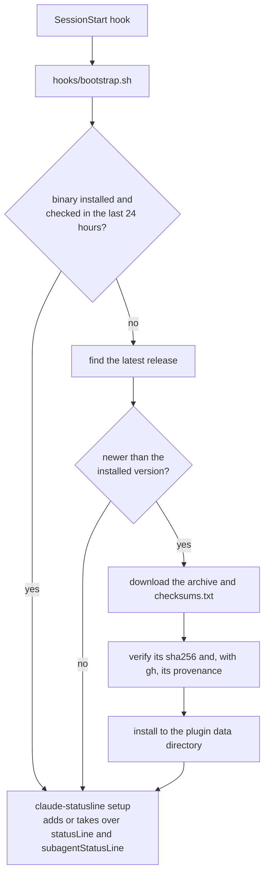

# How it works

For what the tool is and how to install it, see the [README](../README.md). For every setting, see [Customising](customising.md).

## What runs when

Claude Code runs the binary every time it redraws the status line, passing the session JSON on stdin. The binary reads your configuration and a few small files, then prints the line.



In order, a render:

1. Layers your `config.yaml` over the defaults built into the binary, key by key. If the file cannot be used, the defaults apply and the line gains a [red row](customising.md#mistakes-in-the-config-file).
2. Saves the payload as the [usage snapshot](#usage-snapshot).
3. Loads the theme, with colour removed when [`NO_COLOR`](#no_color) is set.
4. Parses the payload, then merges its rate limits with the [shared cache](#shared-rate-limit-cache).
5. Reads the [transcript](#transcript-diagnostics) for the few facts the line takes from it.
6. Runs your [custom segment](customising.md#custom-segments) scripts.
7. Renders each segment in the order of `segments`, then lays the result out in one row, or wraps it to fit `$COLUMNS` (see [Wrapping](customising.md#wrapping)).

The `subagent` command is the same idea for Claude Code's agent panel; see [Subagent rows](customising.md#subagent-rows).

The binary prints the line with no trailing newline, and the status line always exits 0. A config file that cannot be used never blanks the line: the defaults apply, and a red row above the line says why. `claude-statusline config-check` is the one command that exits 1 when the config cannot be used. Control characters are stripped from every string taken from the session, and any other unexpected input results in blank output rather than an error, because a blank status line is better than a broken one.

## Shared rate-limit cache

Rate limits belong to your account, not to a session, and an idle session's payload goes stale. Readings are therefore shared between sessions through the `cache/ratelimits` file in its state directory (see [Where the files live](#where-the-files-live)). A session replaces the cached reading only with a newer window, higher usage, or a drop of more than 10 points (a mid-window quota reset), and the line is always drawn from the merged value. The file is private state and may change between versions.

## Transcript diagnostics

These segments are read from the session transcript (`transcript_path` in the payload). Only its first 40 lines and last 200 lines are read, each within a few megabytes, so a huge transcript costs nothing extra, and it is not read at all unless a listed segment needs it; a missing or unreadable transcript simply hides them. The `model` segment also uses it, and the rest are in the usage group (see [Wrapping](customising.md#wrapping)).

| Segment | Shows | When |
|---|---|---|
| `model` | `Haiku 4.5 (skill)` instead of the model name and effort | The latest assistant turn in the transcript ran a different model family (read from the model id, so a new one needs no change here) than the session's, as happens when a skill or subagent sets its own model. |
| `boot` | `⌂ 64.5k` | Prompt tokens on the first assistant turn: the system prompt, tools, skill listing and memory before you have said anything. |
| `skills` | `⚙ 9.5k` | Size of the skill listing that is always loaded, as its length in characters divided by 4. |
| `skills_stripped` | `✗ skills 3/12` in red | 3 of 12 listed skills had their descriptions stripped to fit the listing budget. |
| `agent_skills` | `✗ agent skills 3/12` in amber | The same, for the subagent with the most stripped skills. |
| `mem` | `✗ mem` in red | A `SessionStart` hook's output was too large to inject, so Claude Code replaced it with a short preview. |

## Usage snapshot

Every time the status line renders, the payload Claude Code sent is saved, byte for byte, to `~/.claude/usage-latest.json` (under `$CLAUDE_CONFIG_DIR` if set) so that other tools can read your latest usage and rate limits. The file is replaced atomically, is readable only by you, and is written only when the payload is valid JSON. A failed write never affects the status line. Set `enabled: false` in the `snapshot` section to turn it off, or `path` there to write it somewhere else.

## NO_COLOR

Set `NO_COLOR` to any non-empty value to turn colour and styling off. A [gradient](customising.md#themes) bar keeps its glyphs and drops every colour:

<picture>
  <source media="(prefers-color-scheme: dark)" srcset="images/gradient-no-color-dark.svg">
  
</picture>

## How the plugin installs and updates

The plugin route adds a step before any of this, so that the binary is installed and wired in without you doing it by hand:



On your next session start, the hook installs the latest release for your platform into the plugin's data directory, `~/.claude/plugins/data/statusline-claude-statusline/bin` (under `$CLAUDE_CONFIG_DIR` if set). Claude Code keeps that directory across plugin updates and deletes it when you uninstall the plugin. Run by hand, without `CLAUDE_PLUGIN_DATA` set, the hook falls back to `~/.claude/claude-statusline/bin`. It checks for a newer release at most once a day, verifies its checksum and, when the GitHub CLI is installed, its build provenance against the release's `provenance.jsonl` bundle, which needs no GitHub login; it never downgrades and keeps the previous binary if anything fails. Without `gh`, the checksum comes from the same release as the archive, so it detects corruption but not a tampered release; the hook says so once. It then runs `claude-statusline setup`, which backs `settings.json` up before it changes anything. Setup adds `statusLine` and `subagentStatusLine` once if you have neither, and if you remove them later it does not add them back. Running `"${CLAUDE_CONFIG_DIR:-$HOME/.claude}/plugins/data/statusline-claude-statusline/bin/claude-statusline" setup` by hand, without `--event`, is the exception: it adds absent entries again. On every session it also points an entry at the current binary when its command is one of the first three of these, and writes nothing when it already does. A leading `~`, `$HOME`, `${HOME}`, `$CLAUDE_CONFIG_DIR` or `${CLAUDE_CONFIG_DIR}` in the path is expanded before it is compared:

- the binary itself;
- the binary of the earlier layout, `~/.claude/claude-statusline/bin/claude-statusline`, with or without the `subagent` argument;
- the binary in any plugin data directory (`.../plugins/data/<plugin>/bin/claude-statusline`), such as one left behind by a plugin that was installed under another name;
- for `statusLine`, a command that is a path ending in `paddle-statusline.sh`, and for `subagentStatusLine`, one ending in `paddle-subagent-statusline.sh`: the old Paddle shell status line. The script must be the whole command, alone or as the only argument of `sh`, `bash`, `zsh` or `dash`; a wrapper that is passed the script is somebody else's. This one is taken over only on the session after an install or update, so going back to the old script on purpose is not undone every session.

Any other command is somebody else's, so it is left as it is, and only the first session message after an install says so. A path counts as this tool's by its shape, either as written or where a symlink resolves to; a link that merely sits at one of these paths but leads to a binary of your own does not make that binary ours. The first session that runs from the data directory also removes the old layout's `cache`, `last-check`, attestation notice and setup markers from `~/.claude/claude-statusline`, once the settings no longer point there; `config.yaml` and the old `bin` stay, in case a wrapper outside `settings.json` still runs it. If either command still mentions `claude-statusline/bin/` in a form that could not be repointed, such as one that starts with an unknown variable, nothing is removed. Within the day between checks, sessions make no network requests.

`claude-statusline uninstall` removes the entries that are this tool's (the first three kinds above, not the old shell script) from `settings.json`, again with a backup, and prints the next step. It keeps the setup markers, so later sessions do not add the entries back; `/plugin uninstall` deletes them with the data directory, so a reinstall starts fresh. When `settings.json` is a symlink, the file it points to is edited and backed up, and the link stays. The plugin's `/statusline:uninstall` command runs it and then uninstalls the plugin itself. See [Uninstall](../README.md#uninstall).

### Where the files live

| File | Location | Removed on uninstall |
|---|---|---|
| The binary, `last-check`, the attestation notice marker, the setup markers, the rate-limit cache and the hook cache | the plugin data directory, `~/.claude/plugins/data/statusline-claude-statusline` | yes, by `/plugin uninstall` (kept by `/statusline:uninstall`, so the entries stay off) |
| Your settings, `config.yaml` | `~/.claude/claude-statusline/config.yaml` | no |
| Custom segment hooks | `~/.claude/statusline.d/` | no |
| The usage snapshot | `~/.claude/usage-latest.json` | no |

All of these are under `$CLAUDE_CONFIG_DIR` if you set it. The status line command does not receive the plugin's environment, so the binary finds its own state from where it is installed: when it runs from `<config dir>/plugins/data/<plugin>/bin/`, that plugin data directory is its state directory. Anywhere else, including a [manual install](#manual-install), its caches stay in `~/.claude/claude-statusline` next to `config.yaml`.

Every release is published from this repository's `release-binaries.yml` workflow, so you can check what you download. The commands under [From a release](#from-a-release) verify the archive against the published checksums and against its build provenance attestation. The plugin does the checksum check for you and, when `gh` is installed, the provenance check too, logged in or not.

## Manual install

### From a release

Each [release](https://github.com/PaddleHQ/claude-statusline/releases) has a binary for macOS and Linux on arm64 and amd64, plus `checksums.txt`, an SBOM per archive and a GitHub build provenance attestation, whose bundle is also published as `provenance.jsonl`. Set the version and your platform, then download, verify and install:

```sh
VERSION=0.1.0   # without the leading v
OS=darwin       # or linux
ARCH=arm64      # or amd64
ARCHIVE="claude-statusline_${VERSION}_${OS}_${ARCH}.tar.gz"

gh release download "v${VERSION}" --repo PaddleHQ/claude-statusline \
  --pattern "$ARCHIVE" --pattern checksums.txt
shasum -a 256 -c checksums.txt --ignore-missing
gh attestation verify "$ARCHIVE" --repo PaddleHQ/claude-statusline

mkdir -p ~/.local/bin
tar -xzf "$ARCHIVE" -C ~/.local/bin claude-statusline
```

`shasum` checks the archive against the published checksums. `gh attestation verify` proves it was built by this repository's `release-binaries.yml` workflow.

### With Go

```sh
go install github.com/PaddleHQ/claude-statusline@latest
```

This builds from source into `$(go env GOPATH)/bin`.

### Configure Claude Code

Add this to `~/.claude/settings.json`, using the path you installed to:

```json
{
  "statusLine": {
    "type": "command",
    "command": "~/.local/bin/claude-statusline",
    "refreshInterval": 60
  },
  "subagentStatusLine": {
    "type": "command",
    "command": "~/.local/bin/claude-statusline subagent"
  }
}
```

`subagentStatusLine` is optional; see [Subagent rows](customising.md#subagent-rows).

Run `claude-statusline --version` to print the installed version.
